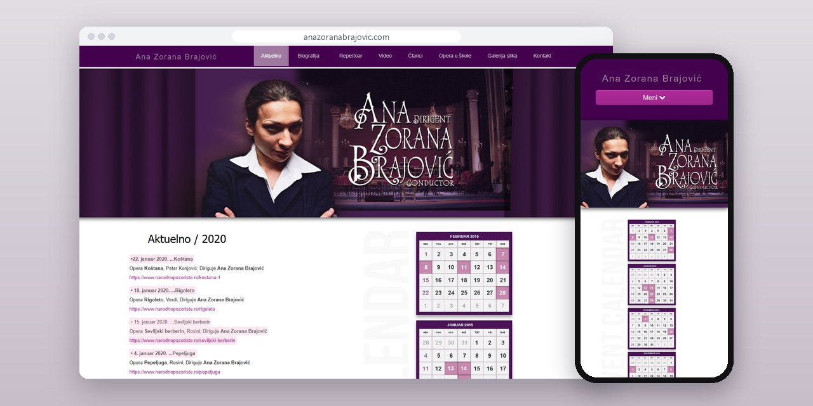
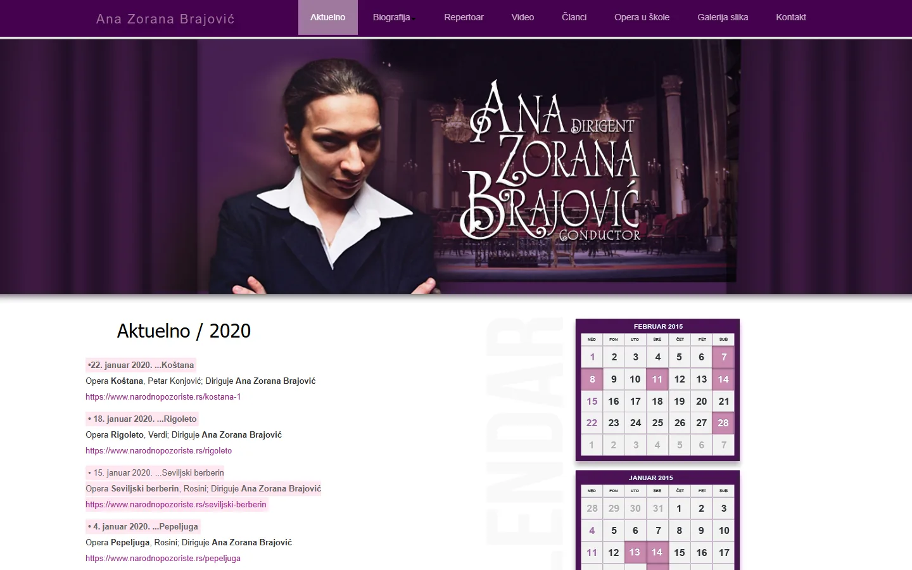
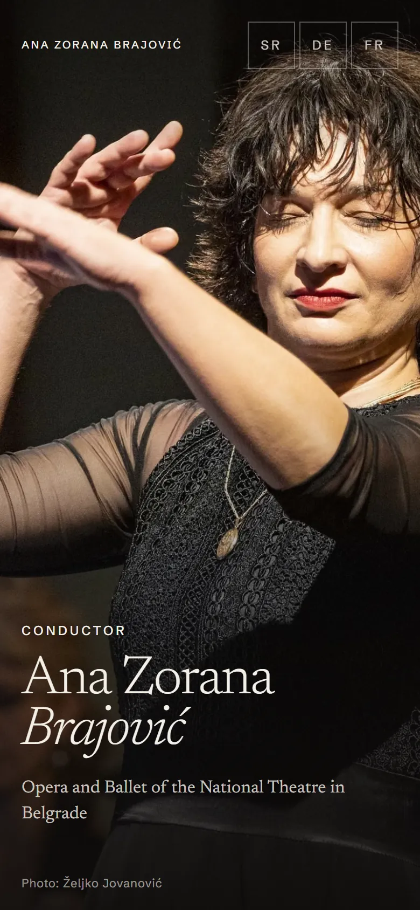
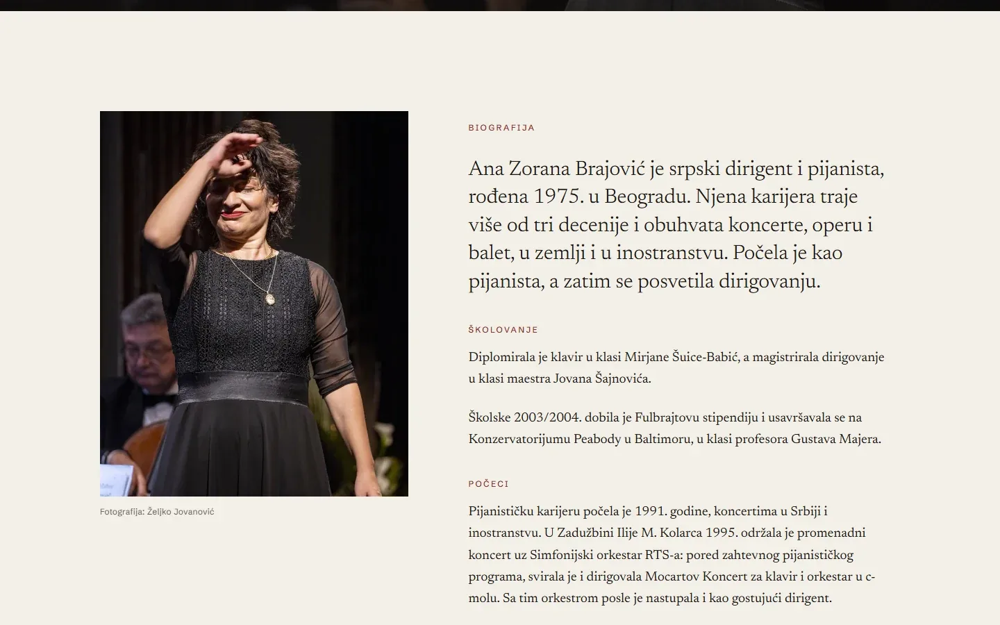
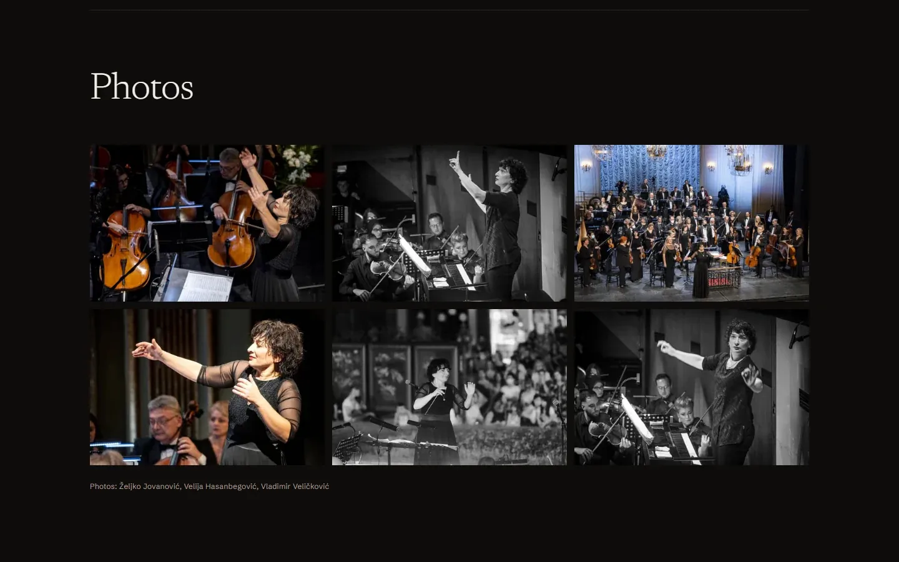

# Ana Zorana Brajović

A four-language portfolio for a conductor of the National Theatre in Belgrade, with a verified biography, recordings and stage photographs.

**[anazoranabrajovic.com](https://anazoranabrajovic.com/)** · [Case study (in Serbian)](https://svilenkovic.rs/radovi/ana-zorana-brajovic) · [Srpski](README.sr.md)

> [!NOTE]
> Client project. The source code belongs to the client and stays in a private repository. This page describes what I built and how.

<table>
  <tr><td><b>Client</b></td><td>Ana Zorana Brajović</td></tr>
  <tr><td><b>Industry</b></td><td>Opera and symphony conducting</td></tr>
  <tr><td><b>Location</b></td><td>Belgrade, Serbia</td></tr>
  <tr><td><b>Type</b></td><td>Four-language artist portfolio</td></tr>
  <tr><td><b>My role</b></td><td>Redesign, development, SEO, mail migration and hosting</td></tr>
  <tr><td><b>Stack</b></td><td>Astro 7, TypeScript, AVIF, WebP, nginx, JSON-LD</td></tr>
</table>

## About the project

Ana Zorana Brajović is a resident conductor of the Opera of the National Theatre in Belgrade and has worked on opera and concert stages for more than thirty years. Her previous site had not been updated since 2020. Because she works with foreign opera houses, orchestras and managers, the new site opens in English at the root address, with Serbian, German and French versions at /sr/, /de/ and /fr/.

Her biography is arranged in four chapters: education and awards, early career at the piano and on the podium, three decades at the National Theatre in Belgrade, and guest appearances. Every date and detail was checked against theatre archives and daily cast lists, with repertoire lists and performance calendars left out at the client's request. Below the biography sit three video recordings and six stage photographs by Željko Jovanović, Velija Hasanbegović and Vladimir Veličković.

## What I built

- One page in four languages (English at the root, Serbian, German and French at /sr/, /de/ and /fr/) with canonical and hreflang tags
- A four-chapter biography checked against the archives of the National Theatre in Belgrade and the National Theatre in Sarajevo
- Three video recordings linked to the artist's YouTube channel with still frames and durations
- A gallery of six stage photographs in AVIF and WebP with photographer credits and an enlarged view
- Permanent redirects from all old addresses (/biografija.html, /biografijaengl.html, /biografijanem.html, /repertoar.html, /video.html, /galerija.html, /kontakt.html)
- Structured data linking the site to Wikipedia, Wikidata, Operabase, the National Theatre, Madlenianum, Teatroslov and IMDb

## Results

| | Performance | Accessibility | Best practices | SEO |
| :-- | :-: | :-: | :-: | :-: |
| Mobile | 98 | 100 | 100 | 100 |
| Desktop | 100 | 100 | 100 | 100 |

PageSpeed Insights, lab test of the live site, November 2026. Security headers: 6 of 6. HTML validator: no errors. axe accessibility check: no violations. Structured data: `Person`.

## Screenshots

<table>
  <tr>
    <td width="68%" valign="top"></td>
    <td width="32%" valign="top"></td>
  </tr>
</table>

Serbian version (/sr/): biography in four chapters checked against theatre sources

Photographs from concerts and productions in Belgrade and Sarajevo, with photographer credits and an enlarged view

---

Built by [D. Svilenković](https://svilenkovic.com).
