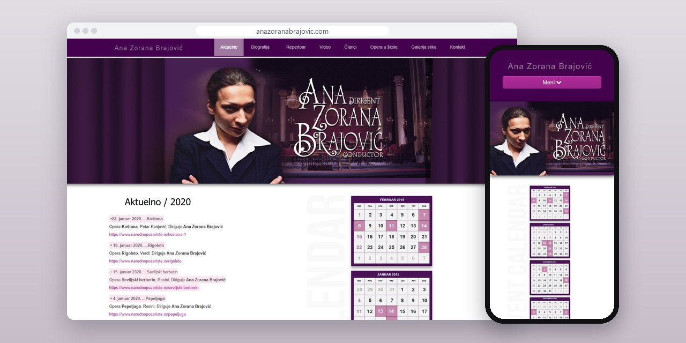
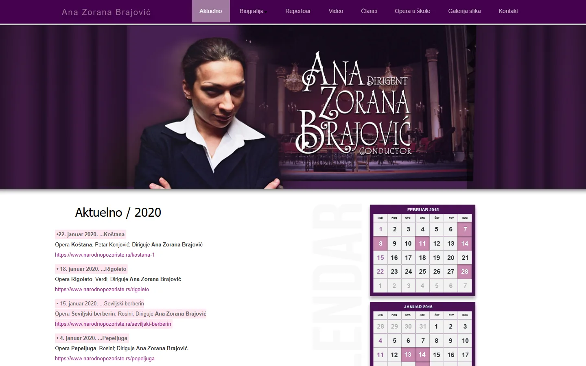
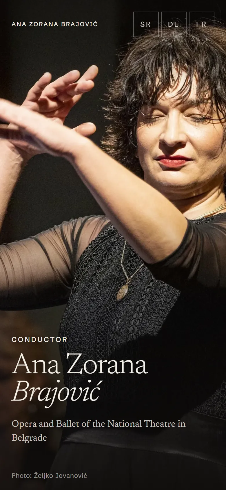
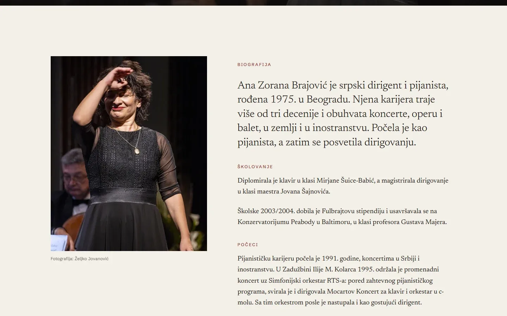
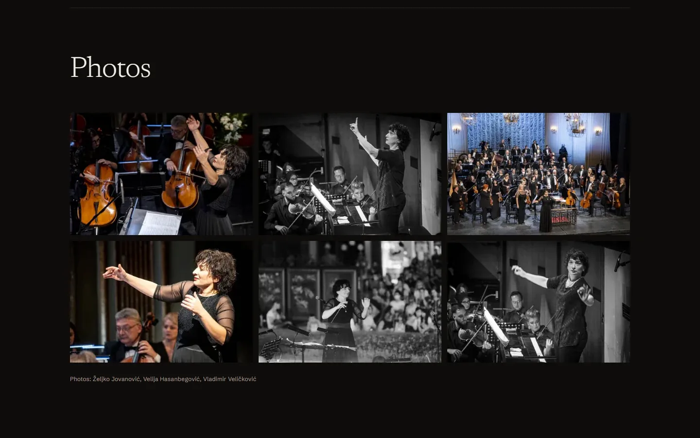

# Ana Zorana Brajović

Četvorojezični portfolio dirigenta Narodnog pozorišta u Beogradu, sa proverenom biografijom, snimcima i fotografijama sa scene.

**[anazoranabrajovic.com](https://anazoranabrajovic.com/)** · [Studija slučaja](https://svilenkovic.rs/radovi/ana-zorana-brajovic) · [English](README.md)

> [!NOTE]
> Klijentski projekat. Izvorni kod pripada klijentu i čuva se u privatnom repozitorijumu. Ova stranica opisuje šta sam uradio i kako.

<table>
  <tr><td><b>Klijent</b></td><td>Ana Zorana Brajović</td></tr>
  <tr><td><b>Delatnost</b></td><td>Opersko i simfonijsko dirigovanje</td></tr>
  <tr><td><b>Lokacija</b></td><td>Beograd</td></tr>
  <tr><td><b>Vrsta</b></td><td>Četvorojezični portfolio umetnika</td></tr>
  <tr><td><b>Moj deo posla</b></td><td>Redizajn, izrada, SEO, prelazak pošte i hosting</td></tr>
  <tr><td><b>Tehnologije</b></td><td>Astro 7, TypeScript, AVIF, WebP, nginx, JSON-LD</td></tr>
</table>

## O projektu

Ana Zorana Brajović je stalni dirigent Opere Narodnog pozorišta u Beogradu i više od trideset godina nastupa na operskim i koncertnim scenama. Njen prethodni sajt nije bio ažuriran od 2020. godine. Zbog međunarodne saradnje sa operskim kućama, orkestrima i menadžerima, novi sajt se na glavnoj adresi otvara na engleskom jeziku, dok su srpska, nemačka i francuska verzija na /sr/, /de/ i /fr/.

Biografija je složena u četiri poglavlja: školovanje i nagrade, počeci za klavirom i dirigentskim pultom, tri decenije u Narodnom pozorištu u Beogradu i gostovanja. Svaki podatak je proveren prema arhivama i dnevnim podelama pozorišta, bez spiskova repertoara i kalendara nastupa po želji klijenta. Ispod biografije su tri video snimka i šest scenskih fotografija Željka Jovanovića, Velije Hasanbegovića i Vladimira Veličkovića.

## Šta sam uradio

- Jedna strana na četiri jezika (engleski na korenu, srpski, nemački i francuski na /sr/, /de/ i /fr/) sa kanonskim i hreflang oznakama
- Biografija u četiri poglavlja proverena prema arhivi Narodnog pozorišta u Beogradu i Narodnog pozorišta Sarajevo
- Tri video snimka povezana sa YouTube kanalom umetnice, sa fotografijom kadra i trajanjem
- Galerija od šest scenskih fotografija u AVIF i WebP formatu sa potpisima autora i uvećanim prikazom
- Trajna preusmerenja sa svih starih adresa (/biografija.html, /biografijaengl.html, /biografijanem.html, /repertoar.html, /video.html, /galerija.html, /kontakt.html)
- Strukturisani podaci koji povezuju sajt sa Vikipedijom, Vikidatom, Operabase-om, Narodnim pozorištem, Madlenijanumom, Teatroslovom i IMDb-om

## Merenja

| | Performanse | Pristupačnost | Dobre prakse | SEO |
| :-- | :-: | :-: | :-: | :-: |
| Telefon | 98 | 100 | 100 | 100 |
| Desktop | 100 | 100 | 100 | 100 |

PageSpeed Insights, laboratorijsko merenje živog sajta, novembar 2026. Sigurnosna zaglavlja: 6 od 6. HTML validator: bez grešaka. axe provera pristupačnosti: bez prekršaja. Strukturisani podaci: `Person`.

## Snimci ekrana

<table>
  <tr>
    <td width="68%" valign="top"></td>
    <td width="32%" valign="top"></td>
  </tr>
</table>

Srpska verzija (/sr/): biografija u četiri poglavlja proverena prema izvorima pozorišta

Fotografije sa koncerata i predstava u Beogradu i Sarajevu, sa potpisima autora i uvećanim prikazom

---

Izrada: [D. Svilenković](https://svilenkovic.rs).
